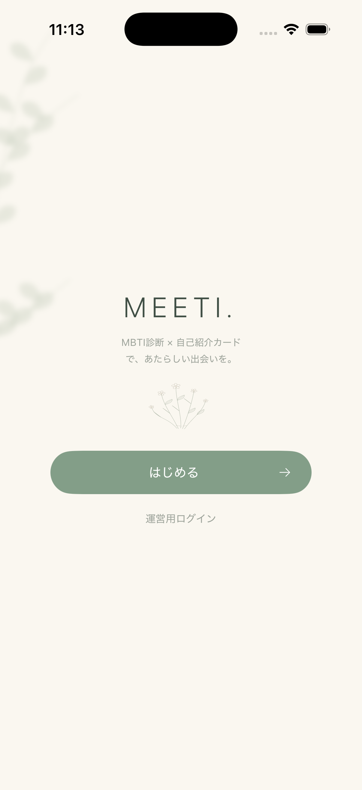
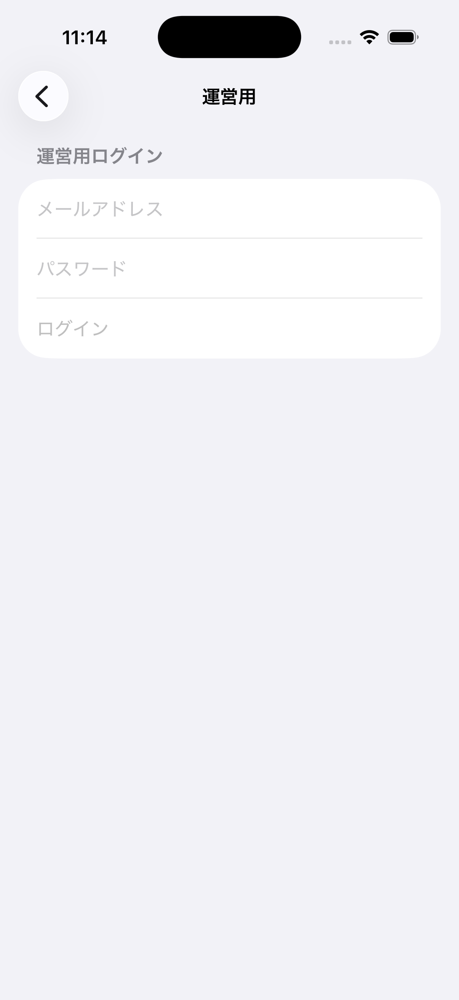
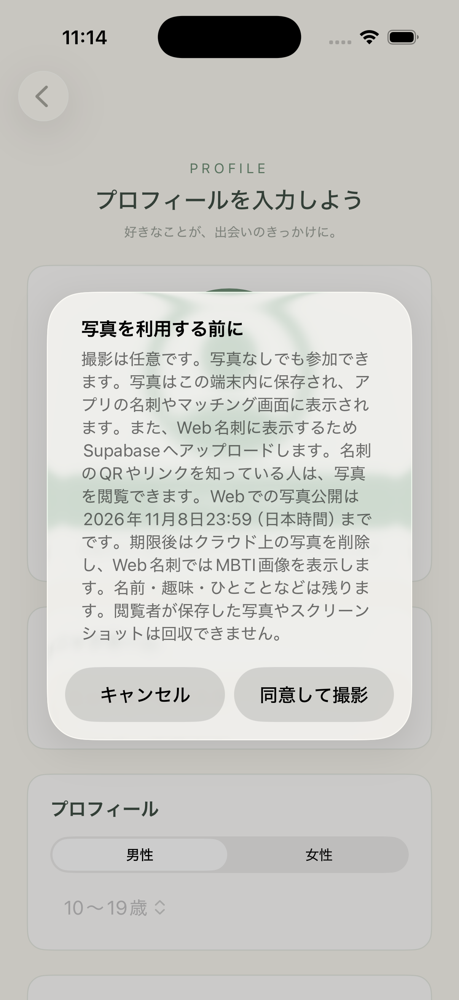

# 日専祭アプリ：MEETI

> **チーム：** 河野結奈、西村優里、中島多笑 
> **AI利用レベル：** 2（生成コード可）
> **最終更新：** 2026-10-19

> 💡 制作の進め方は担任の先生から案内があります。このファイルの項目は、担任の先生の指示で増えることがあります。

---

## 何ができるアプリか（3行）
文化祭の来場者が、簡易MBTI診断と自己紹介から自分だけのデジタル名刺を作成できるアプリです。 その日の参加者データをもとに、MBTIや趣味などから相性の良い人を見つけることができます。 作成した名刺はQRコードを使って自分のスマートフォンに持ち帰ることができます。

（例：買い物リストを作るアプリ。品名を入力して追加できる。買ったものにチェックを付けると一覧から消える。）

## 画面

<h2>アプリ画面</h2>

  
  
  
  

## 使った文法・技術
@State
@Binding
VStack
HStack
Button
NavigationLink
.sheet
.alert
Image
var 
if/else
if let
nil
struct
Array
Data

（例：`@State`、`List`、`ForEach`、構造体、配列の `append` と `remove`）

## 生成AIの使い方（どの場面で、どう使ったか）
・QRコードの生成の仕組みを教わった。
・クラウドに写真を保存する方法と、SupaBaseの使い方を説明してもらった。
・CodexとChatGPTでGitHubの使い方を教わった。（ターミナルでの操作方法）

（例：画面の骨組みは ChatGPT に書いてもらった。削除ボタンが効かなかったので、原因を質問して直した。）

## 展示で工夫した点

（例：文字を大きくして、来場者が操作しやすいようにした。）
